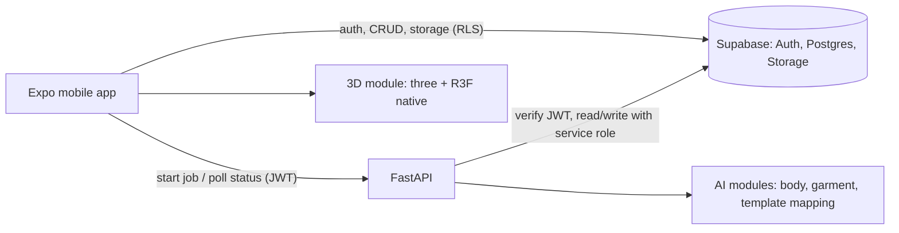

# Architecture

> Status: **planned design**. Sections are updated to match real code as phases land.

## Components

## Responsibility split
- **Supabase direct from mobile (RLS-protected):** auth, profile, wardrobe metadata edits,
  outfit CRUD, avatar appearance edits, signed-URL reads of private images. No custom
  endpoint for these.
- **FastAPI only for:** scan validation, avatar parameter estimation, garment segmentation
  & analysis, template mapping, file validation, deletion cascades that touch storage.
- **No queue.** Long jobs: the API sets `status=processing`, runs via FastAPI
  `BackgroundTasks`, writes `status=ready|failed` + error. The app polls. A queue is
  added only if measured need arises (ADR-0004).

## Data flow: scan → avatar
1. App creates `body_scans` row (RLS) and uploads 3 images to `scan-images/{uid}/{scan}/…`.
2. App calls `POST /v1/scans/{id}/validate` → API downloads images, runs checks, stores report.
3. App calls `POST /v1/scans/{id}/avatar` → job estimates body params → upserts `avatars`.
4. App polls `GET /v1/avatars/{id}`; on `ready` loads GLB base + params in 3D module.

## Data flow: garment → wearable
1. Upload to `wardrobe-images/{uid}/{item}/original.jpg`; row `processing_status=queued`.
2. `POST /v1/wardrobe/{id}/analyze` → segmentation → colour/pattern/category analysis →
   `ai_output` (JSONB, immutable) → template mapping → `garment_asset` (template id +
   material params).
3. User reviews; edits stored in `user_corrections` (JSONB). Effective value =
   correction ?? ai_output.

## 3D module boundary (`apps/mobile/src/three`)
Public API: `<AvatarViewer avatar={AvatarParams} outfit={GarmentAsset[]} pose={Pose} />`.
Screens pass plain typed data; the module owns loading, materials, morphs, attachment.

## Module map (mobile)
`src/features/{auth,profile,scan,avatar,wardrobe,outfit}/{api,hooks,components,types}`,
`src/shared/{ui,theme,lib}`, `src/three/`. Routes in `app/` (expo-router) are thin.
